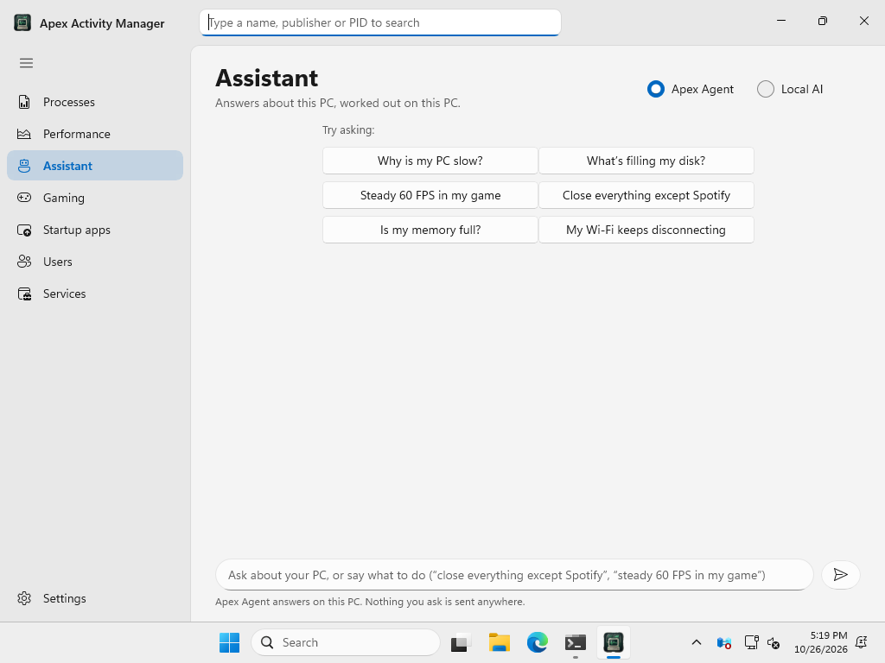
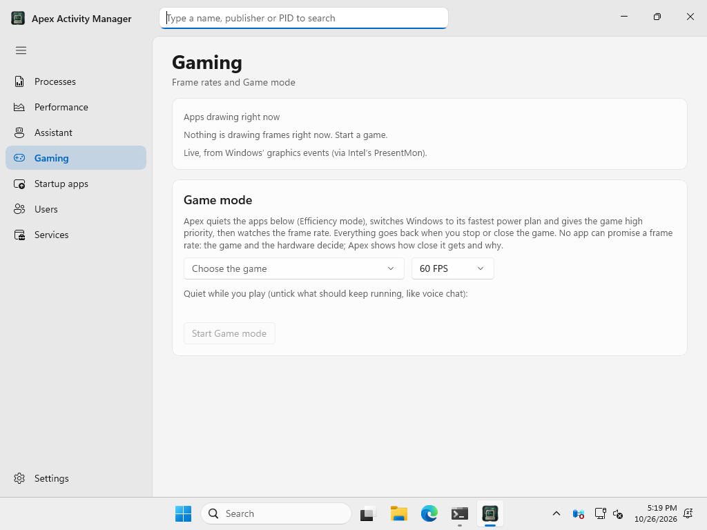
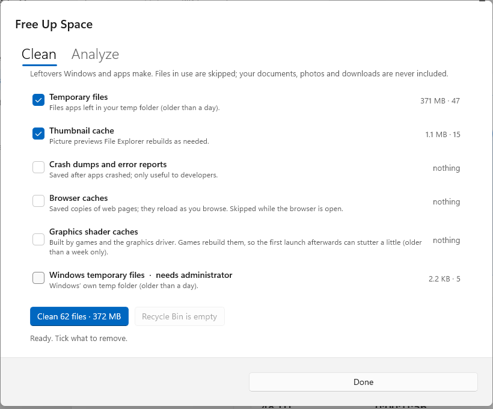
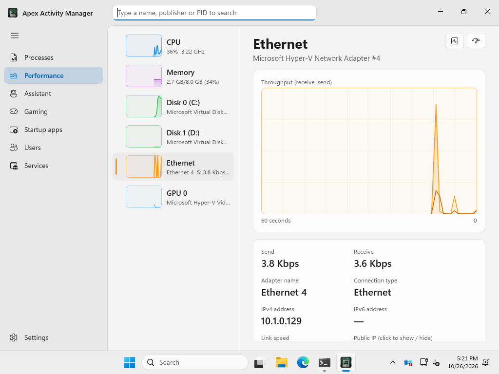
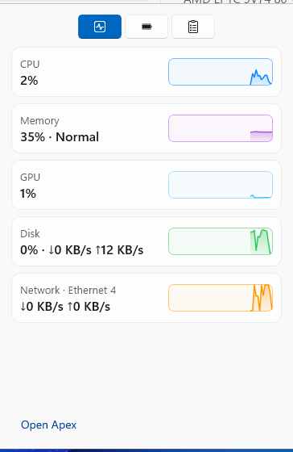

# Apex Activity Manager for Windows

**See what your PC is doing, in plain words.**

By **CyberNet Labs** · designed and built by sudo-user

[Download](https://github.com/sudo-user101/Apex-Activity-Manager-for-Windows/releases/latest) ·
[Changelog](CHANGELOG.md) ·
[Apex for Mac](https://github.com/sudo-user101/Apex-Activity-Manager-MacOSX)

  

## What it is

A native Windows activity manager, laid out the way Task Manager is (so
everything is where you'd expect it) with a few touches from the Mac
edition: a translucent sidebar, rounded cards, large bold titles, soft graph
fills and gentle animations.

## Features

- **Processes.** Apps, background processes and Windows processes, each
  program with its processes underneath, heat-shaded CPU, memory, disk and
  GPU columns, and search from the title bar. **End task** acts only on the
  exact process you chose, never on one that took its place. Put an app in
  **Efficiency mode** to keep it running while it uses less: power-saving
  cores, lowest priority, first to give back memory, minimized; it follows
  the app's new processes and switches off when you bring the app back.
  **Restore all** brings everything back.
- **Free Up Memory** (Memory page): your apps by memory; Efficiency mode,
  trim their memory now, or close them and **Reopen** them later.
- **Memory compression** (Memory page): whether it's on and what it holds,
  the page file in use, how much memory is read back from disk, and a
  switch to turn compression on or off (as administrator; after a restart).
- **Assistant:** ask about your PC in plain words, or say what to do:
  “why is my PC slow?”, “close everything except my music app”, “steady
  60 FPS in my game”. **Apex Agent** answers with this PC's readings and acts
  only when you press its button; **Local AI** chats with a model running on
  this PC (LM Studio or Ollama), and nothing leaves the PC; **Lumen AI** is
  CyberNet Labs' own cloud AI (coming soon: a monthly plan or API access,
  with your key kept in Windows' Credential Manager).
- **Gaming:** live FPS, 1% low and frame time for every app that's drawing,
  and **Game mode**: other apps quieted, the fastest power plan, the game
  at high priority, and the frame rate watched against your target, with
  what's holding it back in plain words. Everything goes back afterwards.
- **Free Up Space** (Disk page): **Clean** temporary files, caches, crash
  reports and Windows Update leftovers (each explained, files in use
  skipped), empty the Recycle Bin, and **Analyze** what takes the space on
  any drive: folders biggest first, the largest files, OneDrive's
  online-only files marked (nothing downloads). **Compress in place** makes
  a folder's screenshots and scans smaller, keeping their names, with the
  originals in the Recycle Bin.
- **Network:** connections by app, ports in use with **Free Port**, your
  public IP (hidden until you click), an internet **speed test**, and
  **Network Doctor**, which checks each step from your PC to the internet
  and says which one fails.
- **Tray panel** (the icon by the clock): **Monitor** (CPU, memory, GPU,
  disk, network with mini graphs), **Energy** (battery, and **Stay Awake**
  for a while or until you turn it off) and **Clipboard** (the last 50
  things you copied, searchable; click to copy again; password managers'
  copies are skipped; kept in memory only). Closing the window keeps Apex
  by the clock; Quit from the icon's menu.
- **Performance.** CPU, memory (with a clear Normal / Elevated / Critical
  pressure), every disk, every network connection and the GPU, each with a
  live graph and the details that matter.
- **Startup apps.** Everything that starts when you sign in, with a switch
  for each.
- **Users** and **Services** (start, stop, restart).

  
  

  
  

  

  
  

## Install

1. Download **Apex-Activity-Manager-1.4.1-Setup-x64.exe** from
   [Releases](https://github.com/sudo-user101/Apex-Activity-Manager-for-Windows/releases/latest).
2. Run it. It installs for you only, without needing administrator rights
   (you can choose all users).
3. The installer isn't code-signed yet, so Windows may show **"Windows
   protected your PC"**: click **More info** › **Run anyway**.

**Requirements:** Windows 10 (version 1809) or later, or Windows 11; 64-bit
(x64; runs on Arm PCs too).

Some actions (ending other users' processes, changing services and
all-users startup apps) need administrator rights: use **Settings ›
Restart as administrator**, or Windows will ask when it's needed.

## Privacy

Apex has no account, no ads and no analytics. Everything it shows is read
on your PC and stays there.

## Third-party software

Frame rates are read with Intel's open-source PresentMon (MIT licence), shipped
with the app; see [THIRD-PARTY-NOTICES.txt](THIRD-PARTY-NOTICES.txt).

## Build from source

C#, WinUI 3 and the Windows App SDK. On Windows with the .NET 8 SDK:

    dotnet test tests/Apex.Core.Tests
    dotnet publish src/Apex.Windows -c Release -r win-x64 -p:Platform=x64 -o publish/x64

`installer/Apex.iss` builds the installer with Inno Setup. Every push is
built on Windows by the [Build workflow](.github/workflows/build.yml): core
tests, every page opened and screenshotted, and a self-test
(`Apex.exe --selftest`) of ending processes, Efficiency mode and the
clipboard history.

## Every computer

Apex's direction is simple: **if it's a computer, it can run Apex.** One app,
the same pages and the same plain words on every operating system and every
kind of hardware:

- **macOS:** Apple silicon and Intel.
- **Windows:** x64 and ARM64 PCs.
- **Linux:** desktops and servers, x86_64 and ARM (64- and 32-bit), the main
  distributions and the small ones.
- More to come, as they're tested: older versions of each system, and other
  operating systems.

Some features depend on what each system allows (fan control or battery
charge limits, for example), so an edition may have fewer of them. When it
does, the app says so plainly instead of hiding the page. Install should
never be the thing that stops you.

## License

**In plain English:** Apex is **free for personal use**. You can download,
install and use it at no cost, and read and build its source code, for
personal and other noncommercial purposes (hobby projects, study,
research, charities, schools).

- ✅ Use it, for free, for anything noncommercial
- ✅ Read the source and build it yourself
- ❌ Modify it or make new works based on it
- ❌ Share or redistribute copies (point people to this page instead)
- ❌ Use it commercially without a separate license

For commercial use, open an issue to contact CyberNet Labs.

The formal terms are the [PolyForm Strict License 1.0.0](LICENSE); if this
summary and the license ever differ, the license applies.

