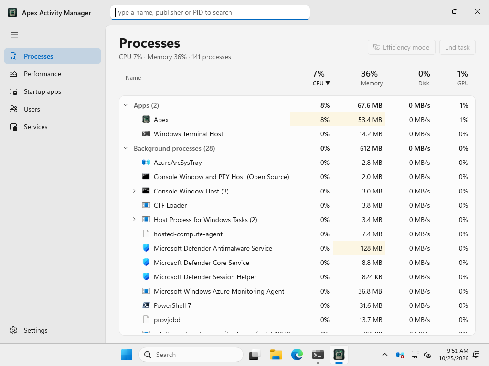
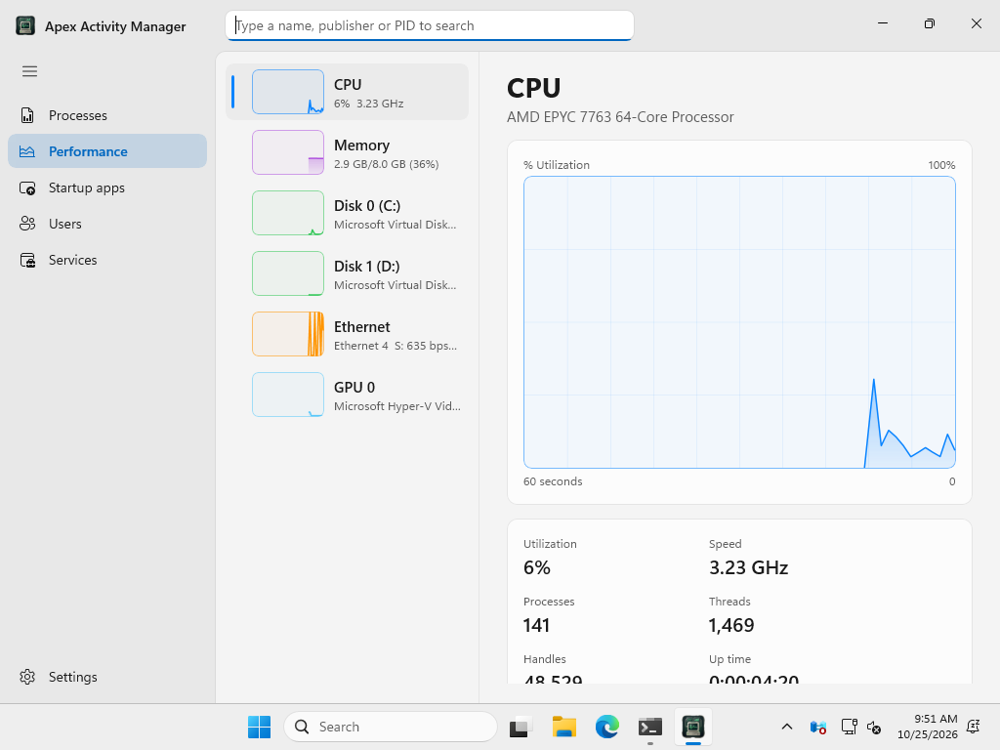
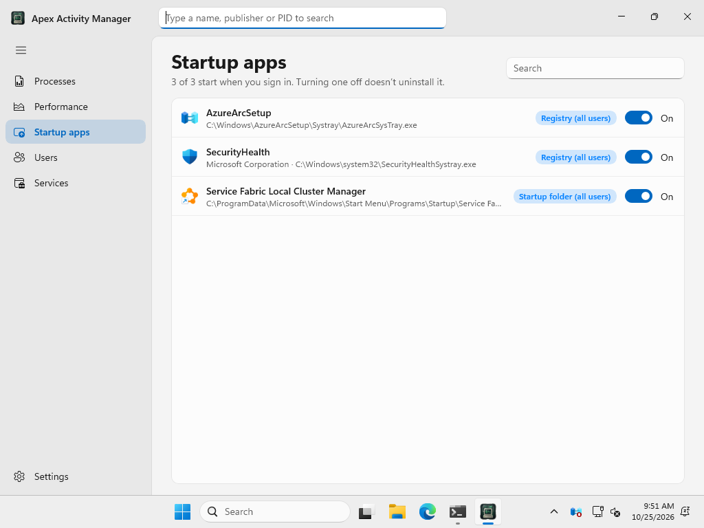

# Apex Activity Manager for Windows

**See what your PC is doing, in plain words.**

By **CyberNet Labs** · designed and built by sudo-user

[Download](https://github.com/sudo-user101/Apex-Activity-Manager-for-Windows/releases/latest) ·
[Changelog](CHANGELOG.md) ·
[Apex for Mac](https://github.com/sudo-user101/Apex-Activity-Manager)

  

## What it is

A native Windows activity manager, laid out the way Task Manager is (so
everything is where you'd expect it) with a few touches from the Mac
edition: a translucent sidebar, rounded cards, large bold titles, soft graph
fills and gentle animations.

## Features

- **Processes.** Apps, background processes and Windows processes, each
  program with its processes underneath, heat-shaded CPU, memory, disk and
  GPU columns, and search from the title bar. **End task**, or put an app in
  **Efficiency mode** to keep it running while it uses less; **Restore all**
  brings everything back.
- **Performance.** CPU, memory (with a clear Normal / Elevated / Critical
  pressure), every disk, every network connection and the GPU, each with a
  live graph and the details that matter.
- **Startup apps.** Everything that starts when you sign in, with a switch
  for each.
- **Users** and **Services** (start, stop, restart).

  
  

## Install

1. Download **Apex-Activity-Manager-1.0.0-Setup-x64.exe** from
   [Releases](https://github.com/sudo-user101/Apex-Activity-Manager-for-Windows/releases/latest).
2. Run it. It installs for you only, without needing administrator rights
   (you can choose all users).
3. The installer isn't code-signed yet, so Windows may show **"Windows
   protected your PC"**: click **More info** › **Run anyway**.

**Requirements:** Windows 10 (version 1809) or later, or Windows 11; 64-bit
(x64; runs on Arm PCs too).

Some actions (ending other users' processes, changing services and
all-users startup apps) need administrator rights: use **Settings ›
Restart as administrator**, or Windows will ask when it's needed.

## Privacy

Apex has no account, no ads and no analytics. Everything it shows is read
on your PC and stays there.

## Every computer

Apex's direction is simple: **if it's a computer, it can run Apex.** One app,
the same pages and the same plain words on every operating system and every
kind of hardware:

- **macOS:** Apple silicon and Intel.
- **Windows:** x64 and ARM64 PCs.
- **Linux:** desktops and servers, x86_64 and ARM (64- and 32-bit), the main
  distributions and the small ones.
- More to come, as they're tested: older versions of each system, and other
  operating systems.

Some features depend on what each system allows (fan control or battery
charge limits, for example), so an edition may have fewer of them. When it
does, the app says so plainly instead of hiding the page. Install should
never be the thing that stops you.

## Licence

Free to use. All rights reserved: see [LICENSE](LICENSE.md). The source code
isn't published.
